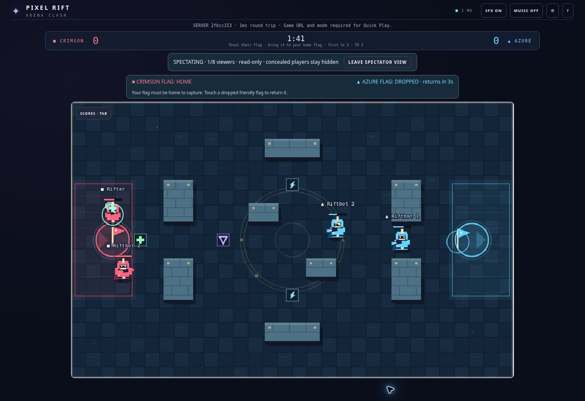

# Pixel Rift: Arena Clash



_Local test capture of Capture the Flag spectator mode._

A free browser-based team arena game for 2–4 players on phones and laptops. Join friends with a room code, invite link, or QR code—no account or installation required.

**[Play Pixel Rift](https://pixel-rift-arena-clash.onrender.com)** · **[Documentation](docs/README.md)**

> **Status:** `1.3.0-alpha.2` event candidate (protocol 4). This is a development preview, not a certified global-scale release.

## Highlights

- **5 classes and 5 weapons**, with Dash, reflective Shield, and 4 selectable specials.
- **5 modes:** Crystal Clash, Blitz, Knockout, Rift Control, and Capture the Flag.
- **5 arenas**, including the two-base Citadel Crossing map.
- **8 spectator seats** separate from the 4 player slots.
- Bot practice, a guided tutorial, and desktop/mobile controls.
- Match contributions for damage, healing, KOs, and objectives.
- Browser-local XP and cosmetic unlocks; combat loadouts are available to everyone.
- Server-authoritative multiplayer built with React, Phaser, TypeScript, Node.js, and Socket.IO.

## What's new in 1.3

The 1.3 expansion is merged into `main`. It requires protocol 4, so older open tabs get a reload prompt.

Capture the Flag, Citadel Crossing, spectators, Medic and Ranger, Arc Repeater and Twin Scatter, expanded results, and cosmetic progression are included in the source. See the [gameplay guide](docs/gameplay.md) for rules and balance values. Confirm the deployed version before using the public game as release evidence.

## Run locally

Install Git and Node.js 24, then:

```bash
git clone https://github.com/DattaAnnavarapu/pixel-rift-arena-clash.git
cd pixel-rift-arena-clash
npm ci
npm run dev
```

Open <http://localhost:3000>. One process serves the client and multiplayer server. See [development](docs/development.md) for LAN play and troubleshooting.

## Test and build

```bash
npm test
npm run build
npm run format:check
```

For the complete release gate, run `npm run release:check` (tests, build, and production smoke checks).

## Documentation

- [Gameplay](docs/gameplay.md): controls, loadouts, modes, arenas, and progression.
- [Development](docs/development.md): setup, project layout, commands, and release checklist.
- [Deployment](docs/deployment.md): Render, verification, and hosting limitations.
- [Historical records](docs/archive/README.md): event plans, pitches, and QA evidence.

## Known limitations

Rooms live in memory on one server: restarting or deploying ends active matches. Free hosting can sleep; keep-alive checks do not guarantee uptime. Progression is stored in your browser and can be lost when storage is cleared. There are no cloud accounts, ranked matchmaking, or regional servers. Future ideas are not shipped features.

## License and credits

Built by [Datta Annavarapu](https://github.com/DattaAnnavarapu). Game art and audio are generated in code. Released under the [MIT License](LICENSE).
