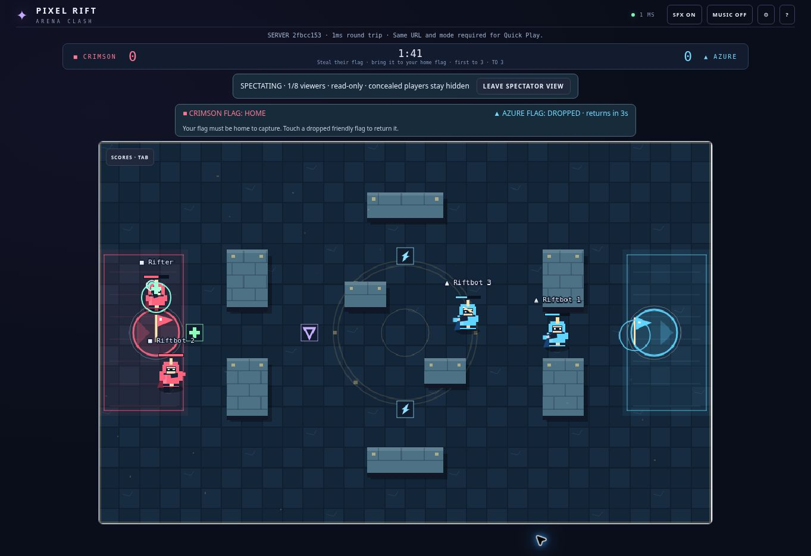

# Pixel Rift expansion — 1.3.0-alpha.1 / protocol 4

Review branch: `feature/rift-expansion`, based on `4a5d2e8` (merged PRs #19 and #18).

## Implemented

- Capture the Flag, Citadel Crossing and flag-aware bots.
- Up to eight spectators separate from four combatants; join mid-match, read-only input/lobby enforcement, concealment and cleanup.
- Actual damage/healing and objective contribution results; live scoreboard.
- Medic/Ranger and Arc Repeater/Twin Scatter; new class crests and weapon accents.
- Browser-local XP, levels, four cosmetic interface themes; completed-round deduplication and legacy profile migration.
- Responsive loadout cards, flag HUD and spectator-only UI.

## Automated evidence

- `npm run release:check`: **140/140 tests passed**, TypeScript check, Vite production build, production HTTP/asset smoke and compiled startup smoke passed.
- The existing damage/cadence suite now covers all 25 class/weapon combinations. Reference 100-HP time-to-KO remains 1.5–4 seconds with and without damage boosts.
- New gameplay regressions: steal/capture/home requirement, teammate returns, 12-second automatic returns, KO/disconnect flag drops, third-capture victory, overtime draw, reset between matches, capped damage, Medic ally healing, XP deduplication and tutorial/spectator/forfeit exclusions.
- Real Socket.IO test: four combatants plus eight spectators, full-room rejection, mid-match watch, synchronized CTF mode/arena/flags, spectator mutation rejection and disconnect cleanup.
- `npm run test:high-ping`: four clients, simulated **400ms RTT, 30ms jitter, 3% loss**; 5,593 snapshots, **0 disconnects, 0 input rejects, 0 desyncs**, complete Blitz round in 94,776ms. This tests transport regression; it is not international physical-device certification.
- After final UI cleanup: production build repeated successfully; static viewport guards and production/compiled smoke checks rerun.

## Browser evidence

Preview: create private room, select Capture the Flag (auto-selects Citadel), fill with bots, select Medic/Arc Repeater/Mend, ready and launch. Verified live canvas, timer, flags, new loadout HUD. A second tab joined the active full room as spectator; reload resumed watching. Removed combat HUD from spectator view and verified dedicated leave control.

The preview has a Vite development-HMR websocket warning; authoritative game snapshots continued updating. This is distinct from the production smoke checks, which pass.

## Manual checks still required before production

- Physical Android/iOS touch controls, portrait/landscape fitting and audio.
- Four human players completing Capture the Flag and rematching; tune new class/weapon feel from playtests.
- Public-host cross-network reconnect and cold start; sustained spectator load.
- Progression persists per browser only, can be edited locally, and does not synchronize across devices. Unlocks are cosmetic interface themes/titles, not character skins or combat upgrades.
- Spectators see live open-field positions and objectives; intended for friendly games, not ranked anti-collusion play.
- Version/protocol change requires all clients to reload. Deploying resets in-memory rooms.

## Release boundary

This is a review candidate. No merge or production deployment was performed. The public Render URL still serves whichever version its owner deployed. Experimental feature switches from v1.2 remain inactive registries; this branch's spectator capability is integrated directly and is not controlled by that registry.
