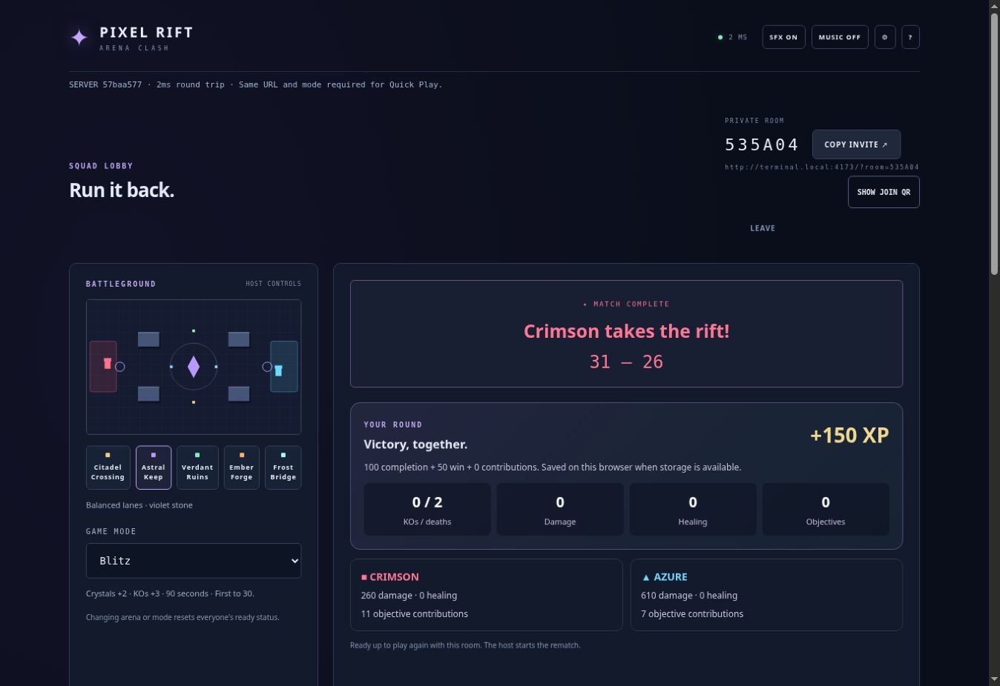

# Stable-play candidate: 1.3.0-alpha.2

This pass addresses stages 1 (reliability) and 2 (player experience). It remains an alpha candidate until physical-device and human playtests pass. Protocol 4 remains compatible; `resultTeam` is an optional snapshot field.

## Changes

- The menu's selected mode now applies to private rooms and bot practice as well as Quick Play. Tutorial keeps its authored Crystal Clash rules.
- CTF stays on Citadel Crossing, enforced by the server and explained in the lobby.
- Finished Quick Play rooms start another five-second countdown only after players ready up. Unready cancels it; private rematches remain host-started.
- Room-code entry accepts lowercase and pasted whitespace, validates six hexadecimal characters, and guards against duplicate/offline submissions.
- Desktop matches have a visible Leave button. Spectators no longer see loadout, ready, or touch-combat controls.
- Movement touches no longer take ownership of aiming; clearing input clears aim ownership too.
- Results show personal stats, a shared XP calculation, team totals, and rematch instructions. Completed-round team identity is retained while players change teams for the next round.
- Class and weapon cards explain their roles; results cards adapt to narrow screens.

## Automated verification

The release gate covers the existing suite plus regressions for all five practice modes, tutorial isolation, CTF map restrictions, public rematch readiness/cancellation, input reset, reward deduplication, team totals, and result identity across team changes. The existing reference balance gate covers all 25 class/weapon combinations with and without damage boosts; no combat stats were changed based only on simulation.

A four-client full Blitz match with simulated 400 ms RTT, 30 ms jitter, and 3% volatile-message loss observed 6,127 snapshots, zero disconnects, zero input rejects, and zero desyncs in 103,794 ms. This is local fault injection, not a production load or international certification.

## Browser verification

The local browser preview completed CTF practice startup and a full Blitz round. A second tab joined as a spectator without taking a player slot or receiving combat/loadout/ready controls. The results screen displayed the final score, +150 XP (completion and win), personal stats, and team totals. This does not replace physical-device testing.

The release gate passed all 149 tests, TypeScript checking, the Vite production build, production asset smoke checks, and compiled server startup. Prettier checks passed. Vite still reports the existing large Phaser bundle warning.

## Manual release gate

- [ ] Two to four human players: complete each mode, ready up, and rematch.
- [ ] Physical Android/iOS: simultaneous move/aim/abilities, release/cancel, rotation, background/resume, and Leave.
- [ ] Human balance review across all classes/weapons and CTF routes.
- [ ] Public deployment: verify exact version, cross-network joining, and reconnect.
- [ ] Long-running room/spectator soak and hosting reliability review.

New modes, accounts, cloud progression, regional hosting, and major renderer changes remain future work. The free-hosting keep-alive setup is unchanged and is not an uptime guarantee.
